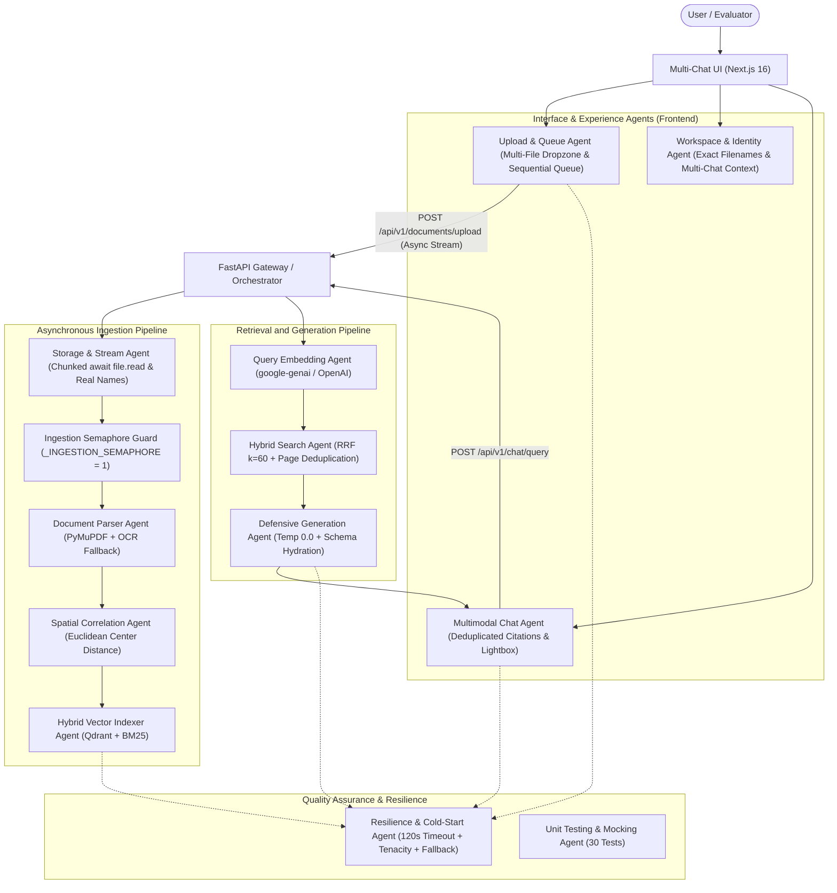

# 🤖 System Agents & Autonomous Roles Definition (AGENTS.md)

This document specifies the architecture of agents and autonomous components that make up the **Multimodal RAG** ecosystem. Each component has defined responsibilities, associated tools, and resilience protocols guided by Clean Architecture principles.

## Important Note for Agents

- Keep the [README.md](./README.md) updated whenever functionality, configuration, environment variables, commands, architecture, deployment, tests, or user-facing behavior are modified.
- Review and update related documentation within the same task; do not leave functional changes unreflected in the README.
- **Language Policy:** All repository documents must be in English, except for those displayed directly to the end-user, the README, and user-facing application texts (which remain in Spanish).

---

## 1. System Agent Map and Operational Flow

---

## 2. Detailed Specification of Agents and Components

### 📱 1. Responsive & Mobile UI Agent (`mobile-ui-agent`)
* **Purpose:** Provide an adaptive mobile-first and desktop-optimized user experience with fluid off-canvas navigation.
* **Code Components:** `frontend/src/app/page.tsx`, `frontend/src/components/sidebar/Sidebar.tsx`, `frontend/src/components/common/Navbar.tsx`, `frontend/src/components/chat/ChatHeader.tsx`, `frontend/src/components/chat/ChatInput.tsx`
* **Responsibilities:**
  1. Off-canvas sliding drawer on mobile (`< lg`) with smooth transition (`translate-x-0` / `-translate-x-full`) and backdrop overlay dismissal.
  2. Dual hamburger button access in both top `Navbar` and `ChatHeader` for one-thumb reachability on mobile devices.
  3. Dynamic viewport adaptation using `h-[100dvh]` to eliminate scrolling overflow caused by mobile browser address bars (Safari/Chrome).
  4. iOS auto-zoom prevention: enforces `text-base sm:text-sm` (16px font-size) on chat input to maintain UI scale on mobile focus.
  5. Touch target accessibility: complies with mobile a11y standards maintaining $\ge 44 \times 44\text{ px}$ interactive touch targets.
  6. Auto-dismissal of mobile drawer upon selecting or creating chats or completing document uploads.

---

### 📤 2. Upload & Queue Agent (`upload-queue-agent`)
* **Purpose:** Enable bulk upload of multiple PDF files and manage an ordered processing queue that protects infrastructure resources.
* **Code Components:** `frontend/src/components/upload/FileDropzone.tsx`, `frontend/src/components/UploadModal.tsx`, `frontend/src/components/upload/IngestionProgressCard.tsx`
* **Responsibilities:**
  1. Enable multi-file selection via file explorer and drag-and-drop (`multiple`).
  2. Enqueue selected files (`fileQueue`) and process them strictly sequentially to avoid exceeding available RAM (512 MB on Render free tier).
  3. Report queue progress in real-time (*"Procesando archivo 1 de N..."*) with progress bars and individual cancellation options.
  4. Automatically associate each indexed document with the active chat workspace upon ingestion completion.

---

### 📄 2. Document Parser & Streaming Agent (`document-parser-agent`)
* **Purpose:** Ingest complex technical PDF documents without blocking the web server or losing visual context.
* **Code Components:** `backend/src/api/routes/documents.py`, `backend/src/adapters/parsers/pymupdf_parser.py`
* **Responsibilities:**
  1. Receive incoming data via non-blocking asynchronous streaming (`while chunk := await file.read(64 * 1024):`), preventing freezes on cloud reverse proxies such as Render.
  2. Extract text blocks (`block_type == 0`) with exact bounding rectangles `Rect(x0, y0, x1, y1)`.
  3. Extract embedded raster and vector images (`doc.extract_image(xref)`).
  4. Discard irrelevant icons and decorative artifacts ($< 25 \times 25 \text{ pts}$).
  5. Extract the original filename and preserve it in chunk metadata (`document_name`).
  6. Automatically trigger Tesseract OCR fallback if a page lacks native digital text ($< 25$ characters).
* **Tools:** PyMuPDF (`fitz`), Pillow (`PIL`), Tesseract OCR.

---

### 📐 3. Spatial Correlation Agent (`spatial-correlation-agent`)
* **Purpose:** Correlate each text chunk with its corresponding visual diagram or schematic on the same page.
* **Code Components:** `backend/src/domain/models.py` (`BoundingBox.distance_to`), `backend/src/adapters/parsers/pymupdf_parser.py`
* **Algorithm:**
  * Computes the Euclidean center:
    $$C(B) = \left( \frac{x_0 + x_1}{2}, \frac{y_0 + y_1}{2} \right)$$
  * Distance between text chunk $T$ and image $I$ on the same page:
    $$D(T, I) = \sqrt{(C(T)_x - C(I)_x)^2 + (C(T)_y - C(I)_y)^2}$$
  * If $D(T, I) \le \text{Threshold}$ ($450 \text{ pts}$), binds `image_id` to the retrievable chunk for visual hydration.
  * If no embedded raster images exist but the page contains vector schematics or OCR scans, generates a full-page capture as visual fallback.

---

### 🔍 4. Hybrid Search & Retrieval Agent (`hybrid-search-agent`)
* **Purpose:** Execute high-precision retrieval combining dense vector similarity and sparse lexical search, organizing sources cleanly.
* **Code Components:** `backend/src/adapters/vector_db/qdrant_adapter.py`, `backend/src/application/use_cases/query_rag.py`
* **Strategy (Reciprocal Rank Fusion - RRF):**
  * Retrieves top candidates from Qdrant (semantic embedding similarity).
  * Retrieves top candidates from BM25 (`rank_bm25` for exact keyword and part number matching).
  * Fuses scores using a smoothing constant $k=60$:
    $$RRF(d) = \frac{1}{60 + \text{rank}_{\text{dense}}(d)} + \frac{1}{60 + \text{rank}_{\text{sparse}}(d)}$$
  * **Dimension Auto-Repair:** If the collection in Qdrant has a different vector dimensionality than configured in `.env`, the adapter detects the mismatch, recreates the collection with the correct dimensions, and ensures `keyword` payload indexes for `document_id`.
  * **Multi-Document Filtering:** Applies strict filtering by the list of `document_ids` associated with the active chat workspace.
  * **Source Deduplication:** Groups retrieved chunks by document and page number to prevent duplicate citations in assistant responses.

---

### 🛡️ 5. Defensive Generation Agent (`defensive-llm-agent`)
* **Purpose:** Generate accurate answers strictly grounded in context and mitigate hallucinations on technical documentation.
* **Code Components:** `backend/src/adapters/llm/gemini_adapter.py`, `backend/src/adapters/llm/openai_adapter.py`, `backend/src/adapters/llm/prompt_budget.py`
* **Operational Rules:**
  1. Sampling temperature: $0.0$ (strict determinism).
  2. Use official modern SDK `google-genai` with automatic fallback to `google-generativeai`.
  3. If retrieved context is insufficient, it **MUST admit it explicitly**:
     > *"Con base en la documentación proporcionada, no cuento con información suficiente para responder a esta pregunta."*
  4. Mandatory source and page citation: `[Fuente: document.pdf, Pág. X]`.
  5. Active diagram reference: if the answer depends on a schematic, instructs the user about the attached rendered diagram.
  6. **Anti-Prompt-Injection Shielding:** Untrusted text in `<document_context>`, `<user_query>`, and history is treated as passive data. Delimiter breakouts (`</document_context>`, `</user_query>`) are automatically sanitized.
  7. **Guaranteed Response:** If the LLM is unavailable, the system directly extracts context from the most relevant chunk so the user is never left without a response.

---

### ⚡ 6. Resilience & Circuit Breaker Agent (`resilience-agent`)
* **Purpose:** Guarantee service availability during network drops, load spikes, LLM rate limits, or cloud container sleep cycles.
* **Code Components:** `tenacity` retry decorators in adapters, timeout controllers in frontend (`frontend/src/lib/api.ts`), memory management (`backend/src/infrastructure/memory.py`).
* **Retry and Resilience Policies:**
  * **Render Free-Tier Cold-Start Tolerance:** Extended client timeouts to **120 seconds** and up to **50 job polling attempts** (~60s) while the container wakes from hibernation.
  * **512MB RAM Protection Protocol (Anti-OOM):**
    1. Sets `MALLOC_ARENA_MAX=2` in `Dockerfile` to eliminate glibc heap fragmentation on Linux cgroups.
    2. Proactive memory reclamation: calls `release_memory()` (`gc.collect()` + `malloc_trim(0)`) after every extracted page, embedding batch, and vector upsert.
    3. Optimized PyMuPDF rendering: uses grayscale snapshots (`colorspace=fitz.csGRAY`, `alpha=False`) and conservative 96 DPI for OCR fallback, cutting bitmap RAM by 75%.
    4. Serialized restart recovery: interrupted ingestion jobs are recovered one by one with startup delay, preventing burst memory spikes on reboot.
    5. Single Uvicorn worker enforcement (`--workers 1`) to guarantee bounded container memory footprint.
  * Captures and retries transient errors: `RateLimitError` (HTTP 429), `APIConnectionError`, and `APITimeoutError`.
  * **Ingestion Quota Recovery Protocol (`WAITING_QUOTA`):** If an embedding call during incremental page processing or batch processing encounters a quota limit or rate limit (HTTP 429, `RESOURCE_EXHAUSTED`, `RateLimitError`), the worker transitions the job to `WAITING_QUOTA` with real-time countdown messaging. It waits for the provider's quota window reset (default 38-40s) and retries up to `max_quota_retries = 6`. Ingestion never fails on transient rate limits unless all retries are exhausted. Supports user cancellation during backoff with automatic cleanup.
  * *Exponential Backoff with Jitter*:
    $$T_{\text{wait}} = \min(\text{max\_wait}, \text{multiplier} \cdot 2^{\text{attempt}})$$
  * If embedding generation fails, automatically degrades to BM25 lexical search.
  * User-friendly contingency messages are always delivered in the chat interface.

---

### 💾 7. Storage & Identity Agent (`storage-agent`)
* **Purpose:** Ensure persistence, file integrity, and exact real document names.
* **Code Components:** `backend/src/adapters/storage/local_storage.py`, `frontend/src/lib/formatters.ts`
* **Responsibilities:**
  1. Store uploaded PDFs in `/app/storage/uploads/` following the pattern `{document_id}_{original_filename.pdf}`.
  2. Store cropped diagram images in `/app/storage/images/{document_id}/`.
  3. Provide `list_uploaded_documents()` to recover human-readable original names without relying solely on RAM or vector DB state.
  4. Faithfully preserve the original filename (casing, spaces, characters) as the chat title via `cleanDocumentTitle`.
  5. Physically cascade-delete files and images upon document deletion.

---

### 🧪 8. Testing & Quality Assurance Agent (`qa-test-agent`)
* **Purpose:** Validate the complete unit test suite and ensure isolation through test doubles (Mocks).
* **Code Components:** `backend/tests/unit/` (45 unit tests)
* **Evaluated Metrics:**
  * Zero live network calls during test execution.
  * Isolation of `LLMPort` and `VectorStorePort` via `unittest.mock.MagicMock`.
  * Verification of the Job state machine (`PENDING` $\to$ `COMPLETED`).
  * Incremental and batched quota recovery with retry ceilings and cancellation validation (`test_use_cases.py`).
  * Context and history character budget validation (`test_prompt_budget.py`).
  * Memory efficiency and cgroup trimming validation (`test_memory_efficiency.py`).
  * Prompt injection shielding and XML delimiter sanitization (`test_security.py`).
  * Asynchronous streaming and upload quota enforcement (`test_upload_storage.py`).
  * Automated execution via `make test`.

---

## 3. Recommended Skills Integration

| Skill | Project Application |
| :--- | :--- |
| **`graphify`** | Extraction of relational code graph and dependencies between Clean Architecture layers. |
| **`modern-web-guidance`** | Best practices for Next.js UI, modular component design, accessible Markdown rendering, and optimized image loading in chat. |
| **`antigravity-guide`** | Agent orchestration maintenance, environment variables management, and slash commands. |
