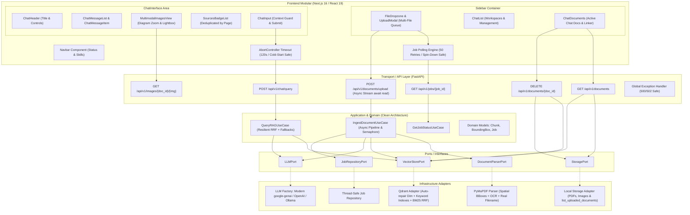

# 🚀 Sistema RAG Multimodal (Arquitectura Limpia & Recuperación Espacial)

Sistema RAG (Retrieval-Augmented Generation) de grado de producción diseñado para procesar, indexar y responder consultas técnicas sobre documentos complejos en formato PDF que contienen texto, tablas y esquemas/diagramas visuales.

---

## 📋 Tabla de Contenidos
1. [Visión General del Sistema](#visión-general-del-sistema)
2. [Diagrama de Arquitectura](#diagrama-de-arquitectura)
3. [Decisiones Técnicas de Diseño](#decisiones-técnicas-de-diseño)
4. [Estructura del Proyecto](#estructura-del-proyecto)
5. [Inventario de Paquetes y Stack Tecnológico](#inventario-de-paquetes-y-stack-tecnológico)
6. [Guía de Ejecución (Docker Compose y Makefile)](#guía-de-ejecución)
7. [Variables de Entorno](#variables-de-entorno)
8. [Despliegue en la Nube (Vercel + Render + Qdrant Cloud)](#despliegue-en-la-nube)
9. [Ejecución de Pruebas Unitarias](#ejecución-de-pruebas-unitarias)

---

## 🎯 Visión General del Sistema

El sistema procesa documentos técnicos en PDF preservando la geometría visual y la correlación espacial entre el contenido textual y las figuras adyacentes.

### Capacidades Clave
* **Espacios de Chat Múltiples:** Permite crear múltiples conversaciones independientes, donde cada chat tiene su propio contexto y documentos asociados de forma aislada.
* **Selector Múltiple de Archivos y Cola Secuencial:** Admite seleccionar y soltar múltiples documentos PDF simultáneamente. El cliente gestiona una cola secuencial (`fileQueue`) para procesarlos de uno en uno, evitando sobrecargar la memoria de la instancia en la nube.
* **Streaming Asíncrono de Subida (No Bloqueante):** La subida a `/api/v1/documents/upload` consume el flujo de bytes de manera asíncrona (`await file.read(64 * 1024)`), eliminando cuellos de botella y congelamientos en proxies de red como Render.
* **Resiliencia ante Hibernación de Render (Free Tier):** Soporta el retardo de arranque en frío (*cold start* de ~50 segundos) característico de las instancias gratuitas de Render mediante timeouts de cliente de hasta 120 segundos y reintentos adaptativos en el sondeo del trabajo (`job polling`).
* **Preservación Fiel del Nombre de Archivos:** Los títulos de chat y las referencias a los documentos conservan estrictamente el nombre original del archivo con sus mayúsculas, minúsculas y caracteres exactos.
* **Fuentes Agrupadas y Deduplicadas:** En las respuestas del asistente, las fuentes citadas se deduplican y agrupan automáticamente por documento y número de página (`Fuente: archivo.pdf, Pág. X`), evitando insignias repetidas.
* **Arquitectura de Frontend Modular:** Interfaz dividida en componentes desacoplados (`Navbar`, `Sidebar`, `ChatList`, `ChatDocuments`, `FileDropzone`, `IngestionProgressCard`, `ChatHeader`, `ChatMessageList`, `MultimodalImagesView`), facilitando el mantenimiento y la escalabilidad.
* **Bloqueo Inteligente de Input:** El campo de texto de consulta y el botón de envío permanecen inhabilitados hasta que el usuario asocia o sube al menos un documento PDF al espacio de chat activo, evitando preguntas sin contexto.
* **Garantía Absoluta de Respuesta:** El chat nunca queda sin respuesta o esperando indefinidamente. Incluye timeout con `AbortController` (120s), fallback a búsqueda léxica BM25 si falla el embedding, extracción directa de contexto si falla el LLM, y entrega obligatoria de mensaje al usuario.
* **Persistencia de Nombres Reales de Documentos:** Los documentos conservan su nombre de archivo original en disco (`/app/storage/uploads/`), en los metadatos vectoriales y en `localStorage`, garantizando que nunca se muestren como UUIDs al recargar la página.
* **Auto-reparación de Dimensiones en Base Vectorial:** Qdrant detecta automáticamente si la colección existente fue creada con una dimensión distinta a la del modelo configurado en `.env` (ej. 1536 vs 768 de Gemini), recreando la colección y configurando los índices de filtrado `keyword` (`document_id`, `chunk_id`) de manera autónoma.
* **Soporte Oficial para `google-genai`:** Migración completa al SDK moderno oficial de Google GenAI (`from google import genai`) con compatibilidad hacia atrás.
* **Memoria Conversacional Multi-Turno:** Soporta preguntas de seguimiento dentro del mismo chat, contextualizando consultas cortas y resolviendo pronombres y referencias continuas.
* **Carga Inmediata y Procesamiento Asíncrono:** La carga arranca de forma inmediata al soltar o seleccionar el PDF. La API responde HTTP 202 con un `job_id` y ejecuta la extracción e indexación en segundo plano (`PENDING` $\to$ `EXTRACTING` $\to$ `INDEXING` $\to$ `COMPLETED`).
* **Eliminación Definitiva de Documentos:** Permite eliminar un documento tanto de la base de datos vectorial (Qdrant) como del índice léxico en memoria (BM25) y del almacenamiento en disco, actualizando los chats en tiempo real.
* **Mapeo Espacial y Multimodalidad:** Extrae bloques de texto e imágenes con sus rectángulos de coordenadas espaciales exactas (*Bounding Boxes* `[x0, y0, x1, y1]`). Correlaciona cada fragmento con los esquemas gráficos más cercanos mediante cálculo de distancia euclidiana.
* **Soporte para Documentos Escaneados (OCR Fallback):** Si un documento carece de texto vectorial nativo, el sistema activa automáticamente Tesseract OCR con extracción de coordenadas por bloque y genera una captura visual de la página.
* **Búsqueda Híbrida (Dense + Sparse con RRF):** Combina similitud semántica de embeddings vectoriales (Qdrant) con búsqueda de palabras clave exactas (BM25Okapi) fusionadas mediante **Reciprocal Rank Fusion (RRF)** con constante $k=60$.
* **Generación Defensiva Anti-Alucinaciones:** El LLM opera a temperatura $0.0$ con directivas estrictas que admiten explícitamente la falta de información cuando el contexto recuperado es insuficiente.

---

## 🏛️ Diagrama de Arquitectura



---

## 📑 Decisiones Técnicas de Diseño

* **Streaming Asíncrono de Carga a Disco:** El endpoint `/api/v1/documents/upload` implementa `while chunk := await file.read(64 * 1024):` de forma totalmente asíncrona. Esto evita el bloqueo del hilo de eventos (*event loop*) de Starlette/FastAPI, asegurando que las transferencias sobre redes remotas o proxies reversos (como Render) no queden congeladas esperando paquetes TCP adicionales.
* **Procesamiento en Cola con Semáforo y Protocolo Anti-OOM (512 MB):** La aplicación combina una cola de ingesta en el frontend con un semáforo de concurrencia en backend (`_INGESTION_SEMAPHORE = 1`). Para garantizar estabilidad estricta en el límite de 512 MB de Render:
  1. Se configura `MALLOC_ARENA_MAX=2` en el contenedor Docker para evitar la fragmentación de arenas de glibc en cgroups de Linux.
  2. Tras cada página procesada, lote de embeddings y upsert vectorial se ejecuta `release_memory()` (recolección forzada de basura + `ctypes.CDLL('libc.so.6').malloc_trim(0)` para devolver páginas de memoria al sistema operativo).
  3. Uvicorn corre forzado con un único worker (`--workers 1`).
  4. Los fallbacks de OCR y capturas de páginas escaneadas se rasterizan en escala de grises (`colorspace=fitz.csGRAY`, `alpha=False`) a 96 DPI, reduciendo el consumo de memoria del pixmap en un 75%.
  5. La recuperación de trabajos interrumpidos en reinicio se ejecuta en serie (no en paralelo) tras un delay de inicialización.
* **Tolerancia a Cold Starts en la Nube:** Debido a que las instancias libres de Render hibernan tras 15 minutos de inactividad, los timeouts de la API del cliente web se fijaron en 120 segundos y el sondeo de estado de jobs soporta hasta 50 reintentos (~60 segundos), acompañados de mensajes descriptivos en la interfaz para informar al usuario mientras la instancia despierta.
* **Recuperación ante Despliegues:** Los trabajos de ingesta se persisten en Redis y los PDFs en `STORAGE_PATH`. Al iniciar una nueva instancia, los jobs no terminales se recuperan automáticamente y se vuelven a procesar desde el archivo persistido. En Render se requiere Redis administrado y un disco persistente montado para el backend; sin ambos, una instancia nueva no puede garantizar la continuidad.
* **Arquitectura Hexagonal Desacoplada:** El transporte HTTP, la lógica de negocio y los servicios externos (LLM, base de datos vectorial, almacenamiento) están completamente aislados mediante interfaces abstractas (`LLMPort`, `VectorStorePort`, `StoragePort`, `DocumentParserPort`). Esto permite alternar entre Gemini, OpenAI o modelos locales en Ollama sin modificar ningún caso de uso.
* **Extracción Espacial con PyMuPDF, Bounding Boxes y Soporte OCR:** En lugar de tratar los PDFs como texto plano sin formato, se extraen las coordenadas geométricas exactas `(x0, y0, x1, y1)` de cada bloque de texto y figura incrustada. Si la página no contiene texto digital (< 25 caracteres), se activa automáticamente un fallback de OCR (Tesseract) con captura de página, garantizando compatibilidad con documentos escaneados.
* **Recuperación Híbrida (Dense Qdrant + BM25 con Reciprocal Rank Fusion):** La búsqueda vectorial captura la similitud semántica conceptual, mientras que BM25Okapi localiza códigos de pieza, números de serie y terminología técnica exacta. Ambos rankings se combinan con RRF:
  $$RRF\_Score(d) = \sum_{m \in M} \frac{1}{60 + rank_m(d)}$$
* **Deduplicación de Citas en UI:** Las fuentes recuperadas por el motor se deduplican agrupando los fragmentos provenientes del mismo documento y número de página, presentando una única referencia visual por página citada.
* **Auto-reparación Vectorial y de Índices en Qdrant:** Si el volumen de Qdrant contiene una colección previa con dimensiones incompatibles (ej. 1536 vs 768), el adaptador lo detecta y recrea la colección automáticamente. Además, asegura los índices de tipo `keyword` necesarios para el filtrado seguro por `document_id`.
* **Persistencia de Nombres Reales en Almacenamiento:** El adaptador de almacenamiento local conserva el nombre original del archivo `{document_id}_{original_name.pdf}`. La API combina estos registros con la base vectorial para que los documentos listados nunca pierdan su nombre legible.

---

## 📁 Estructura del Proyecto

```text
multimodal-rag/
├── Makefile                          # Tareas de orquestación y desarrollo
├── docker-compose.yml                # Orquestación de servicios (API, Frontend, Qdrant, Redis)
├── README.md                         # Documentación técnica completa
├── AGENTS.md                         # Definición de agentes y roles del sistema
├── .dockerignore                     # Exclusión de archivos para contexto de Docker raíz
├── .env.dist                         # Plantilla de variables de entorno global
│
├── backend/                          # Servicio Backend FastAPI (Clean Architecture)
│   ├── Dockerfile
│   ├── requirements.txt
│   ├── .dockerignore                 # Exclusión de storage/, venv y caches para builds rápidos
│   ├── .env.dist                     # Plantilla de variables del backend
│   ├── main.py                       # Entrypoint con inyección de sys.path y soporte de puerto dinámico
│   ├── src/
│   │   ├── domain/                   # Entidades de negocio puras (Chunk, BoundingBox, Job, etc.)
│   │   ├── ports/                    # Puertos / Interfaces abstractas (LLM, VectorStore, Parser, etc.)
│   │   ├── application/              # Casos de uso (IngestDocument, QueryRAG, GetJobStatus)
│   │   ├── adapters/                 # Implementaciones (PyMuPDF, Qdrant, LLMFactory, LocalStorage)
│   │   ├── infrastructure/           # Configuración Pydantic y Contenedor de Inyección
│   │   └── api/                      # Rutas REST (documents, chat, health) y Global Exception Handler
│   └── tests/
│       └── unit/                     # Pruebas unitarias con Mocks de LLM, VectorDB y Seguridad (30 tests)
│
└── frontend/                         # Cliente Web Next.js 16 (App Router Modular)
    ├── Dockerfile
    ├── package.json
    ├── .dockerignore                 # Exclusión de node_modules y .next para builds limpios
    ├── next.config.mjs               # Configuración de producción de Next.js
    ├── .env.dist                     # Plantilla de variables del frontend
    └── src/
        ├── app/                      # Layout, estilos globales y página principal multi-chat
        ├── components/               # Componentes modulares desacoplados:
        │   ├── common/               # Navbar y encabezados globales
        │   ├── sidebar/              # Sidebar, ChatList, ChatDocuments
        │   ├── upload/               # FileDropzone (multi-file), IngestionProgressCard
        │   ├── chat/                 # ChatHeader, ChatMessageList, ChatMessageItem, ChatInput,
        │   │                         # SourcesBadgeList (deduplicado), MultimodalImagesView
        │   ├── UploadModal.tsx       # Contenedor modal orquestador de subida
        │   ├── ChatInterface.tsx     # Orquestador del panel de chat activo
        │   └── SkillsModal.tsx       # Modal de habilidades y capacidades técnicas
        ├── lib/                      # Cliente API HTTP (api.ts) y formateadores (formatters.ts)
        └── types/                    # Modelos y contratos de TypeScript
```

---

## 📦 Inventario de Paquetes y Stack Tecnológico

### Backend (Python / FastAPI)

| Paquete | Versión Mínima | Función Arquitectónica |
| :--- | :--- | :--- |
| **`fastapi`** | `0.162.0` | Framework web asíncrono para transporte REST. |
| **`uvicorn[standard]`** | `0.54.0` | Servidor ASGI de alto rendimiento para concurrencia asíncrona. |
| **`python-multipart`** | `0.0.32` | Procesamiento en streaming de archivos PDF multipart. |
| **`pydantic`** | `2.14.2` | Validación estricta y serialización de modelos de dominio. |
| **`pydantic-settings`** | `2.16.2` | Inyección tipada de variables de entorno desde `.env`. |
| **`pymupdf`** | `2.0` | Extracción de bloques de texto, OCR y coordenadas espaciales de diagramas. |
| **`pillow`** | `13.0.0` | Procesamiento y compresión de imágenes y diagramas técnicos. |
| **`qdrant-client`** | `1.20.0` | Conexión con base de datos vectorial Qdrant con query points y auto-indexación. |
| **`rank-bm25`** | `0.2.2` | Motor de búsqueda léxica BM25Okapi para palabras clave exactas. |
| **`google-genai`** | `0.1.1` | SDK moderno oficial de Google GenAI para modelos Gemini y embeddings. |
| **`google-generativeai`**| `0.8.6` | Fallback de compatibilidad para Google Generative AI. |
| **`openai`** | `3.41.0` | Cliente oficial para modelos OpenAI y embeddings. |
| **`tenacity`** | `9.2.1` | Resiliencia con reintentos exponenciales y jitter ante Rate Limits (HTTP 429). |
| **`pytest`** | `9.2.0` | Suite de pruebas unitarias automatizadas. |
| **`httpx`** | `0.28.1` | Cliente HTTP asíncrono para llamadas a servicios externos y pruebas. |

### Frontend (Next.js 16 / React 19)

| Paquete | Versión | Función en la Experiencia de Usuario (UI/UX) |
| :--- | :--- | :--- |
| **`next`** | `16.4.3` | Framework con App Router y optimización de producción. |
| **`react` & `react-dom`** | `19.3.1` | Librería reactiva de interfaz con renderizado concurrente. |
| **`typescript`** | `7.0.2` | Tipado estricto alineado con los modelos del backend. |
| **`tailwindcss`** | `4.3.3` | Motor de utilidades CSS para diseño responsive y tema oscuro. |
| **`lucide-react`** | `1.65.0` | Iconografía técnica accesible para interfaces de ingeniería. |
| **`react-markdown`** | `10.1.0` | Renderizado seguro de respuestas técnicas en Markdown. |
| **`remark-gfm`** | `4.0.1` | Formato para tablas técnicas y bloques estructurados. |

---

## ⚡ Guía de Ejecución

Es posible levantar y administrar toda la solución utilizando tanto el **Makefile** unificado como **Docker Compose**.

### Comandos del Makefile

```bash
# 1. Configurar variables de entorno iniciales (.env)
make setup

# 2. Levantar toda la solución en segundo plano (API, Frontend, Qdrant, Redis)
make up

# 3. Ver los contenedores activos del proyecto (equivalente a docker ps)
make ps

# 4. Ver los logs en tiempo real (todos los servicios o uno específico)
make logs
make logs backend
make logs frontend

# 5. Detener y bajar todos los contenedores
make down

# 6. Reiniciar los servicios
make restart

# 7. Ejecutar las pruebas unitarias
make test
```

### Usando Docker Compose directamente

```bash
# Construir imágenes y levantar servicios en modo desatendido (-d)
docker compose up --build -d

# Consultar el estado de los servicios activos
docker compose ps

# Ver logs en tiempo real
docker compose logs -f

# Detener todos los servicios
docker compose down
```

Una vez en ejecución, los servicios estarán disponibles en:
* **Frontend Web (Next.js):** [http://localhost:3000](http://localhost:3000)
* **API Backend (Documentación Swagger / OpenAPI):** [http://localhost:8000/docs](http://localhost:8000/docs)
* **Panel Administrativo de Qdrant:** [http://localhost:6333/dashboard](http://localhost:6333/dashboard)

---

## 🔑 Variables de Entorno

Configuradas centralmente en `.env`:

```bash
ENVIRONMENT=production
PORT=8000
HOST=0.0.0.0

# Base de Datos Vectorial (Qdrant)
VECTOR_STORE_PROVIDER=qdrant
QDRANT_URL=http://localhost:6333
QDRANT_API_KEY=""
QDRANT_COLLECTION_NAME=technical_documents

# Proveedor de LLM (gemini / openai / ollama)
LLM_PROVIDER=gemini
LLM_PROVIDER_API_KEY=tu_api_key_aqui
LLM_MODEL=gemini-2.5-flash

# Modelo de Embeddings
EMBEDDING_MODEL=models/text-embedding-004
EMBEDDING_DIMENSION=768

# Presupuesto de tokens de generación (ajustable por cuota/coste)
LLM_MAX_CONTEXT_CHARS=12000
LLM_MAX_HISTORY_CHARS=2400
LLM_MAX_OUTPUT_TOKENS=512
LLM_THINKING_BUDGET=0

# Almacenamiento local de documentos e imágenes
STORAGE_PATH=./storage

# Configuración CORS
CORS_ORIGINS=["http://localhost:3000", "https://*.vercel.app"]
```

---

## ☁️ Despliegue en la Nube

1. **Base de Datos Vectorial (Qdrant Cloud):**
   * Crear clúster en [cloud.qdrant.io](https://cloud.qdrant.io).
   * Obtener el endpoint `https://<cluster-id>.cloud.qdrant.io:6333` y la API Key correspondiente.

2. **Backend API (Render.com):**
   * Crear un nuevo *Web Service* conectado al repositorio.
   * Root Directory: `backend`
   * Build Command: `pip install -r requirements.txt`
   * Start Command: `uvicorn main:app --host 0.0.0.0 --port $PORT`
   * Configurar variables en el panel: `LLM_PROVIDER`, `LLM_PROVIDER_API_KEY`, `LLM_MODEL`, `EMBEDDING_MODEL`, `EMBEDDING_DIMENSION`, `LLM_MAX_CONTEXT_CHARS`, `LLM_MAX_HISTORY_CHARS`, `LLM_MAX_OUTPUT_TOKENS`, `QDRANT_URL`, `QDRANT_API_KEY`.
   * **Nota sobre la capa gratuita de Render:** La instancia hiberna tras 15 minutos sin peticiones. La primera llamada puede tardar ~50 segundos en despertar; el cliente web incluye tolerancia extendida de 120s para soportar este comportamiento sin fallar. El perfil `RESOURCE_PROFILE=free` limita los PDF a `MAX_UPLOAD_SIZE_MB=10` para reducir el riesgo de quedarse sin memoria o cuota durante la extracción, OCR y embeddings. En una instancia con más recursos usa `RESOURCE_PROFILE=standard` y configura explícitamente `MAX_UPLOAD_SIZE_MB=50` (o un valor menor según la cuota del modelo).
   * Configura `REDIS_URL` con la URL de una instancia Redis administrada, no con `redis://redis:6379/0` fuera de Docker Compose.
   * Agrega un Persistent Disk al Web Service y configura `STORAGE_PATH` exactamente igual a su **Mount Path absoluto**. Para este servicio, si el disco está montado en la ruta que muestra el log, usa `STORAGE_PATH=/opt/render/project/src/storage`. El endpoint `/ready` devuelve `503` si Redis no está disponible o si `STORAGE_PATH` no es una ruta absoluta escribible.
   * En Render Free, usa almacenamiento externo para que los PDF sobrevivan a reinicios: configura `STORAGE_PROVIDER=supabase`, `SUPABASE_URL`, `SUPABASE_SERVICE_ROLE_KEY` y `SUPABASE_STORAGE_BUCKET`. Crea previamente el bucket privado `documents` en Supabase Storage. Nunca expongas `SUPABASE_SERVICE_ROLE_KEY` al frontend.
   * La limpieza es en cascada: al cancelar, borrar o fallar una carga se eliminan los vectores parciales de Qdrant, el PDF local/remoto, las imágenes extraídas locales/remotas y los archivos temporales. Si falla la creación del job después de guardar el PDF, el endpoint intenta eliminar inmediatamente todos esos artefactos.
   * En Render Free, el límite local se mantiene por debajo de los 512 MB: `MAX_LOCAL_STORAGE_MB=400` y `MIN_FREE_STORAGE_MB=64`. Con Supabase activo, el PDF y las imágenes se conservan remotamente y las copias temporales locales se eliminan al terminar la ingesta.
   * Para proteger la RAM de 512 MB, `MAX_EXTRACTED_IMAGE_MB=2` omite imágenes embebidas sobredimensionadas y `MAX_IMAGES_PER_DOCUMENT=80` limita la cantidad de imágenes conservadas por PDF. `OCR_DPI=96` rasteriza páginas escaneadas en escala de grises para recortar un 75% el uso de memoria de pixmaps MuPDF.
   * La ingesta guarda cada página en Qdrant al terminarla. Si Render reinicia el proceso, Redis conserva el job y la reanudación vuelve a procesar de forma idempotente las páginas ya guardadas, sin duplicar vectores; el progreso confirmado no depende de que la extracción completa llegue al final.
   * Si aparece `Cannot recover job: upload is missing`, Redis conservó el estado del job pero el PDF no existe en `STORAGE_PATH/uploads`. Verifica el disco persistente, el `mount path` y que `STORAGE_PATH` apunte a ese montaje; ese archivo debe volver a subirse si ya fue eliminado por un despliegue anterior.
   * Para evitar picos de memoria durante PDFs grandes, embeddings y Qdrant usan lotes pequeños (`EMBEDDING_BATCH_SIZE=6`, `QDRANT_UPSERT_BATCH_SIZE=6`) y BM25 mantiene un límite en memoria de `BM25_MAX_CHUNKS_IN_MEMORY=800`. Los datos completos permanecen en Qdrant.
   * La búsqueda léxica también indexa el nombre del documento. Las consultas sobre marca, fabricante, modelo, nombre o resumen activan una muestra document-scoped para no depender únicamente de la similitud vectorial.

3. **Frontend (Vercel):**
   * Importar el repositorio en [vercel.com](https://vercel.com).
   * Root Directory: `frontend`
   * Variable de entorno: `NEXT_PUBLIC_API_URL=https://<tu-servicio>.onrender.com`
   * Define `NEXT_PUBLIC_MAX_UPLOAD_SIZE_MB` con el mismo valor de `MAX_UPLOAD_SIZE_MB` para rechazar archivos grandes desde el navegador antes de iniciar la transferencia.

---

## 🧪 Ejecución de Pruebas Unitarias

```bash
make test
```

### Cobertura de las Pruebas (42 tests):
* `test_security.py`: Verificación de defensas contra Prompt Injection, neutralización de etiquetas XML y validación de límites de entrada.
* `test_bounding_boxes.py`: Validación de coordenadas geométricas, intersecciones y cálculo de distancia euclidiana espacial.
* `test_upload_storage.py`: Verificación de streaming binario de subida y eliminación segura en caso de exceso de tamaño.
* `test_use_cases.py`: Verificación del flujo de `IngestDocumentUseCase` y `QueryRAGUseCase` con aislamiento de interfaces, checkpoints por página, OCR fallback e imágenes recuperadas.
* `test_memory_efficiency.py`: Validación de recolección de basura, llamada segura a `malloc_trim(0)` e ingesta incremental con streaming de páginas.
* `test_qdrant_images.py`: Pruebas de hidratación de imágenes extraídas, tokenización de nombres de documento y consultas de identidad.
* `test_resilience.py`: Validación de reintentos exponenciales (*Exponential Backoff*), respuestas defensivas y omisión de presupuestos de pensamiento innecesarios.
* `test_prompt_budget.py`: Comprobación de límites y presupuestos de caracteres de contexto e historial.
* `test_factory.py`: Verificación del intercambio dinámico de proveedores de LLM (`LLMFactory`).
